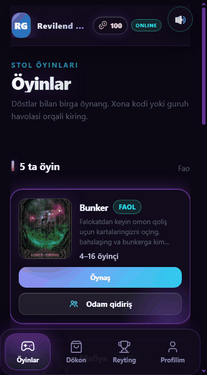
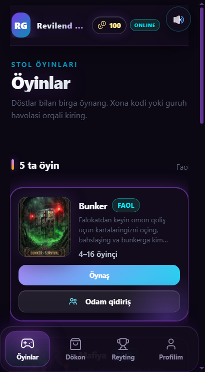
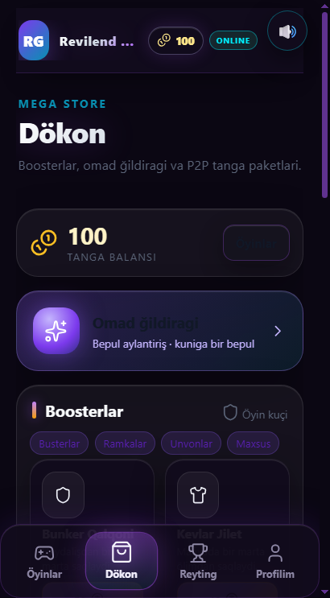
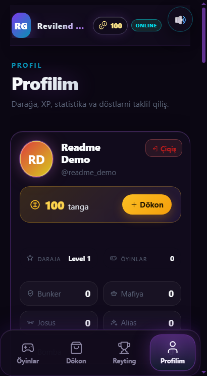
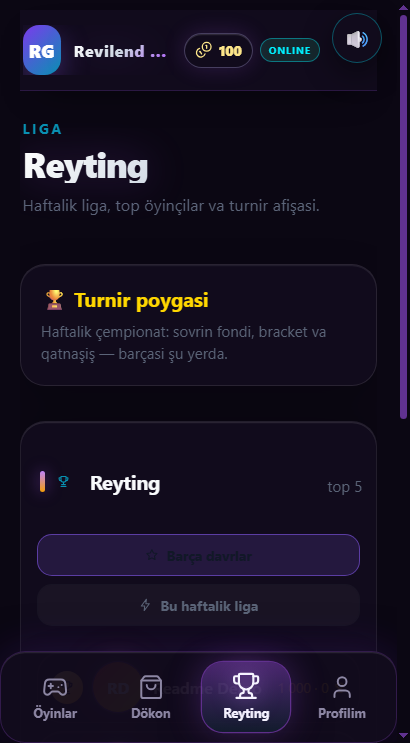
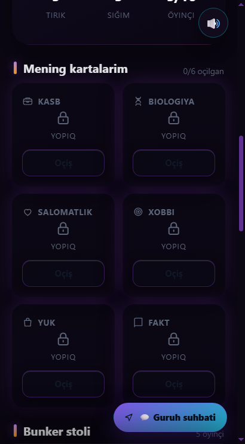

<div align="center">

# 🎮 Revilend Games

### Telegram Bot + Mini App (TMA) ko‘p o‘yinchi stol o‘yinlari platformasi

Bitta Telegram bot, bitta FastAPI server va bitta zamonaviy Mini App — Bunker, Mafiya, Josus, Alias va Portlovchi Bomba uchun to‘liq o‘yin, iqtisodiyot va turnir ekotizimi.

[](https://t.me/revilend_gamesbot)
[](https://t.me/revilend_gamesbot?startapp)
[](https://www.python.org/)
[](https://docs.aiogram.dev/)
[](https://fastapi.tiangolo.com/)
[](https://supabase.com/)
[](https://tailwindcss.com/)
[](https://developer.mozilla.org/docs/Web/JavaScript)
[](https://render.com/)

**O‘zbek tilida · Real vaqt · Telegram WebApp · Server-side iqtisodiyot**

</div>

---

## 📚 Mundarija

- [Loyiha haqida](#-loyiha-haqida)
- [Mini App](#-mini-app)
- [O‘yinlar katalogi](#-oyinlar-katalogi)
- [Iqtisodiyot va monetizatsiya](#-iqtisodiyot-va-monetizatsiya)
- [Kibersport va turnirlar](#-kibersport-va-turnirlar)
- [Texnik arxitektura](#️-texnik-arxitektura)
- [Xavfsizlik](#-xavfsizlik)
- [O‘rnatish](#️-ornatish)
- [Muhit o‘zgaruvchilari](#-muhit-ozgaruvchilari)
- [Ishga tushirish](#️-ishga-tushirish)
- [Render’ga deploy](#️-renderga-deploy)
- [VPS’da ishga tushirish](#️-vpsda-ishga-tushirish)
- [Testlar](#-testlar)
- [Loyiha tuzilishi](#-loyiha-tuzilishi)
- [API va WebSocket](#-api-va-websocket)
- [Admin panel](#️-admin-panel)
- [Ko‘p tillilik (i18n)](#-kop-tillilik-i18n)
- [Litsenziya va aloqa](#-litsenziya-va-aloqa)

---

## 🚀 Loyiha haqida

**Revilend Games** — Telegram ichida ishlaydigan ko‘p o‘yinchi stol o‘yinlari platformasi. Foydalanuvchi bot orqali o‘yin yaratadi, do‘stlarini taklif qiladi, Mini App’da kartalar va ovoz berish bilan real vaqtda o‘ynaydi.

Platforma bitta jarayonda ishlaydi:

- **aiogram 3.x** — Telegram bot, buyruqlar, inline tugmalar va admin panel;
- **FastAPI** — Mini App API, autentifikatsiya va WebSocket;
- **Telegram Mini App** — mobil qurilmaga moslashgan o‘yin interfeysi;
- **Supabase (PostgreSQL)** — foydalanuvchilar, inventar, tranzaksiyalar, turnirlar va tarix;
- **Render / VPS** — yagona web service sifatida deploy.

> Bot va API bitta FastAPI `lifespan` ichida ishlaydi. Shu sababli alohida bot processi shart emas.

### Asosiy imkoniyatlar

- 🎮 5 ta to‘liq o‘yin rejimi
- ⚡ WebSocket orqali real vaqt yangilanishlari
- 🪙 Server-side tanga balansi va xarid tarixi
- 🛍️ Do‘kon, boosterlar, ramkalar va unvonlar
- 🎡 Omad g‘ildiragi va kunlik streak
- 🏆 Haftalik turnirlar va avtomatik bracket
- 👥 Referal tizimi
- 🛠️ To‘liq admin panel
- 💾 Har kuni avtomatik JSON zaxira
- 🔐 Telegram `initData` HMAC tekshiruvi

---

## 📱 Mini App

Mini App Telegram ichida ochiladi va mobil ekranga moslashadi. Quyida lokal demo foydalanuvchisi bilan olingan haqiqiy interfeys skrinshotlari keltirilgan.

<p align="center">
  
</p>

| O‘yinlar | Do‘kon | Profil |
|:---:|:---:|:---:|
|  |  |  |
| 5 ta o‘yin, xona kodi va jamoa bilan o‘ynash | Tanga paketlari, boosterlar, ramkalar va unvonlar | Balans, daraja, statistika va do‘stlarni taklif qilish |

| Reyting | O‘yin xonasi |
|:---:|:---:|
|  |  |
| Haftalik liga, turnir va eng yaxshi o‘yinchilar | Bunker xonasi, o‘yin kartalari va ovoz berish |

---

## 🎲 O‘yinlar katalogi

| O‘yin | O‘yinchilar | Tavsif |
|:---|:---:|---|
| 🛡️ **Bunker** | 4–16 | Katastrofadan keyin xarakteristikalarni ochib, bunkerga kim kirishini bahslashish. |
| 🕵️ **Mafiya** | 4–20 | 15+ ta boyitilgan rol, tun/kun fazalari, komissar, shifokor, don va boshqalar. |
| 🕶️ **Josus (Spyfall)** | 3–12 | 25+ lokatsiya, niqoblanish, savol-javob va josusni topish. |
| 🐊 **Alias / Krokodil** | 2–20 | Guruhda tezkor so‘z tushuntirish, taqiqlangan so‘zlar va ochkolar poygasi. |
| 💣 **Portlovchi Bomba** | 2–8 | Exploding Kittens uslubidagi xavfli karta o‘yini. |

### 🛡️ Bunker

- Har bir o‘yinchi 6 ta xarakteristika kartasini oladi: kasb, biologiya, sog‘liq, bagaj, xobbi va fakt.
- Falokat hamda maxsus kartalar har raundda vaziyatni o‘zgartiradi.
- Bunker sig‘imi, tirik o‘yinchilar va ovoz berish tartibi serverda boshqariladi.
- Bunker Qalqoni, 2x ovoz va boshqa boosterlar o‘yin ichida ishlaydi.

### 🕵️ Mafiya

- 15+ ta rol va 3 ta asosiy fraksiya: tinch aholi, mafiya va yolqizlar.
- Tun fazasida maxsus harakatlar, kunduzgi muhokama va interaktiv ovoz berish.
- Komissar, shifokor, don, advokat, manyak, masxaraboz va boshqa rollar.
- Kevlar jilet, rol almashtirish va ovoz boosterlari.
- Mini App va guruh xabarlari o‘rtasida sinxron holat.

### 🕶️ Josus (Spyfall)

- 25+ lokatsiya va har bir lokatsiya uchun maxsus rollar.
- 3–6 o‘yinchida 1 ta, 7 va undan ko‘p o‘yinchida 2 ta josus.
- Josus joyni topishga urinadi, tinch aholi esa savollar orqali uni aniqlaydi.
- Josus radari noto‘g‘ri variantlarni qisqartiradi.

### 🐊 Alias / Krokodil

- Har raundda bitta tushuntiruvchi va vaqt chegarasi.
- So‘zning o‘zini, qismlarini yoki taqiqlangan 3 ta so‘zni aytish mumkin emas.
- To‘g‘ri javob va tushuntiruvchi uchun tanga mukofoti.
- 2–20 o‘yinchi uchun moslashgan tezkor raundlar.

### 💣 Portlovchi Bomba

- **Bomb, Defuse, Attack, Skip, Future, Shuffle va Steal** kartalari.
- Har bir o‘yinchida bitta Defuse va to‘rtta harakat kartasi.
- Qo‘shimcha defuse, ko‘rish va kartani o‘g‘irlash mexanikalari.
- 2–8 o‘yinchi uchun tez va dinamik partiyalar.

---

## 🪙 Iqtisodiyot va monetizatsiya

### P2P tanga xaridi

1. Foydalanuvchi Mini App yoki botdagi do‘kondan tanga paketini tanlaydi.
2. **Humo / Uzcard** kartasiga to‘lov qiladi.
3. To‘lov chekini (screenshot) botga yuklaydi.
4. Admin chekni tekshirib tasdiqlaydi yoki rad etadi.
5. Tasdiqlangach tangalar avtomatik balansga qo‘shiladi.

> Karta raqami va egasi `.env`dan emas, bazadagi `system_settings` jadvalidan olinadi. Admin panel orqali o‘zgartiriladi.

### Do‘kon va boosterlar

| Buyum | Vazifasi |
|:---|:---|
| 🛡️ **Bunker Qalqoni** | Bunkerda haydalishdan bir marta saqlaydi. |
| 🦺 **Kevlar Jilet** | Mafiyada bir marta o‘limdan saqlaydi. |
| ✖️ **2x Ovoz** | Ovozni ikki barobar kuchli qiladi. |
| 🛰️ **Josus Radari** | Josus o‘yinida 3 ta noto‘g‘ri joyni o‘chiradi. |
| ⏳ **Vaqt Ustasi** | Vaqt bilan bog‘liq afzallik beradi. |
| 🧲 **Bomba Magniti** | Portlovchi Bomba o‘yinida kartani boshqarishga yordam beradi. |

### Omad g‘ildiragi — Lucky Spin

- Interaktiv roulette animatsiyasi.
- Standart aylanish narxi — **20 tanga**.
- Kunlik bepul aylanish va qo‘shimcha chiptalar.
- Turli mukofotlar: tangalar, boosterlar, chiptalar va noyob buyumlar.

### Profil ramkalari va unvonlar

**Ramkalar:** Oltin, Neon, Olovli Ajdaho, Kiber Glitch, Olmos VIP.

**Unvonlar:** Mafiya Otaxoni, Daxlsiz, Ko‘rinmas Soya va boshqalar.

Ramka va unvonlar Mini App profilida, reytingda va guruh xabarlarida ko‘rinadi.

### Kunlik streak va referallar

- 1–7 kunlik streak: **25 → 35 → 50 → 70 → 100 → 150 → 250 tanga**.
- Har bir taklif qilingan yangi do‘st uchun **+75 tanga**.
- Taklif oqimi nosozlikka chidamli: `users`/`referrals` jadvali xato bersa ham `/start` to‘xtamaydi, yangi o‘yinchi xush kelibsiz xabarini va menyuni oladi, taklif qiluvchi esa baribir mukofot oladi (xato faqat logga yoziladi).
- Profil 15 sekundlik xotira keshida (`PROFILE_CACHE_TTL`) saqlanadi: `/start` va menyu tugmalari Supabase’ga har safar so‘rov yubormaydi, javob odatda 0.5 sekunddan tez. Har qanday yozuv (tanga, til, blok) keshni darhol tozalaydi.
- Rol tekshiruvi (`is_admin` → `get_role`) ham shu keshdan, Do‘kon balansi esa `account_for()` orqali o‘qiladi: `/start` va Do‘kon takror ishlaganda qo‘shimcha Supabase so‘rovi ketmaydi.
- O‘lchov (`scripts/bench_latency.py --simulate`, har so‘rov 120 ms): mavjud foydalanuvchi `/start` sovuq keshda 1 so‘rov (~120 ms), takroriy bosishda 0 so‘rov; Profil va Do‘kon kesh bilan 0 so‘rov; Missiyalar va Reyting 2 so‘rov (missiya holati va reyting jadvali real o‘qiladi). Yangi foydalanuvchi + taklif havolasida xush kelibsiz xabari ~2 so‘rovda, taklif mukofoti va admin bildirishnomasi esa undan keyin bajariladi.

### Tezlikni o‘lchash

- `python scripts/bench_latency.py --user-id <telegram_id> --runs 5` — haqiqiy Supabase bilan `/start` va pastki menyu tugmalarini (Profil, Do‘kon, Missiyalar, Reyting, O‘yinlar ro‘yxati, Turnirlar) o‘lchaydi: har bir run uchun vaqt, birinchi javob vaqti va Supabase so‘rovlari soni logga yoziladi, oxirida mediana/min/max jadvali chiqadi.
- `--json bench.json` natijalarni faylga yozadi; `--allow-write` yangi foydalanuvchi + taklif havolasi va kunlik bonusni ham o‘lchaydi (vaqtinchalik yozuvlarni o‘zi o‘chiradi); `--simulate` credentialsiz sinov uchun (soxta Supabase, `--latency` bilan).
- Mini App tomoni: skript `/api/bootstrap` ni in-process (ASGI `TestClient`) chaqirib o‘lchaydi — sovuq kesh va kesh bilan, so‘rovlar soni bilan; oxirida bot `/start` va Mini App bootstrap medianalari solishtiriladi. O‘lchovni `--no-bootstrap` bilan o‘chirish mumkin.
- O‘lchov Telegram tarmoq vaqtini o‘z ichiga olmaydi (xabar yuborish simulyatsiya qilinadi), ya’ni baza + handler mantiqi vaqti ko‘rsatiladi.
- `tests/test_menu_latency.py` — 0.5 sekundlik byudjet va so‘rovlar soni byudjetini qo‘riqlaydi: 100 ms/so‘rov simulyatsiyasida har bir menyu tugmasi birinchi javobni 0.5 s ichida berishi, `/start` sovuq keshda 1 (kesh bilan 0), Profil va Do‘kon 1/0, Missiyalar 3, Reyting 3/2 so‘rovdan oshmasligi tekshiriladi. Yangi Supabase chaqiruvi qo‘shilsa yoki kesh ishlamay qolsa test yiqiladi.

### Zero-lag arxitektura (bot + Mini App)

- **30 sekundlik RAM kesh:** `PROFILE_CACHE_TTL = 30` — profil, rol va balans o‘qishlari keshdan qaytadi (0 so‘rov, ~0 ms), har qanday yozuv keshni darhol tozalaydi.
- **Waterfall yo‘q:** bot handlerlari Supabase’ni `asyncio.to_thread` bilan bloklamaydi, mustaqil so‘rovlar `asyncio.gather` bilan parallel ketadi — Reyting (reyting + shaxsiy hisob), Missiyalar (hisob + missiya yozuvlari), Profil/Do‘kon (bitta kesh so‘rovi).
- **Lock serializatsiyasi yo‘q:** `EconomyStore` dagi global lock endi faqat kesh/in-memory holatni himoyalaydi; Supabase SELECT/INSERT/UPDATE lar lock ostida bajarilmaydi, shuning uchun `gather` dagi so‘rovlar haqiqatan bir vaqtda ketadi (`tests/test_parallel_reads.py` buni qo‘riqlaydi).
- **Doimiy 30 s kesh hamma yo‘lda:** `ensure_user` ham avval RAM keshni tekshiradi (ism o‘zgarmagan bo‘lsa), shuning uchun har bir tugma bosilishida profil Supabase’dan qayta o‘qilmaydi.
- **Xarid hech qachon bekor bo‘lmaydi:** `shop.buy` tangani yechib, buyumni `user_inventory` ga darhol yozadi; `shop_transactions` ga tarix yozish xatosi faqat logga tushadi — foydalanuvchi «Xarid tarixini saqlab bo‘lmadi» xatosini ko‘rmaydi va xarid bekor qilinmaydi.
- **Klaviatura:** pastki menyuning 5-qatorida «🌐 Tilni oʻzgartirish» + «👥 Doʻstlar», 6-qatorida keng «🌐 Mini App (Portal)» (`web_app`) tugmasi turadi; portal tugmasi `include_web_app=False` bo‘lsa ham matn tugmasi sifatida qoladi.

### Yuqori yuklamaga tayyorlik (High-Scale Production)

- **60 s in-memory TTL kesh (`core/cache.py`):** `TTLCache` — thread-safe, TTL + hajm chegarasi (50 000 yozuv, eng eskisi chiqariladi). Profil/rol/balans o‘qishlari keshlanadi; takroriy `/start`, Profil, Do‘kon bosishlarida Supabase so‘rovi **0** bo‘ladi (`EconomyStore.cache_stats()` hit rate beradi). Har qanday yozuv (tanga sarflash, o‘yin natijasi, rol) keshni darhol tozalaydi.
- **Connection pooling / sessiya reuse:** barcha store’lar bitta persistent `httpx.Client` (keep-alive, 200 ulanish, 10 s timeout) orqali ishlaydi — `create_supabase_client()` har so‘rovda TLS handshake qilmaydi, DB osilib qolsa so‘rov 10 s da uziladi.
- **Xarid tarixi fon oqimida:** `shop_transactions` yozuvi `ThreadPoolExecutor` ga topshiriladi; tanga yechilishi va `user_inventory` yozuvi sinxron bo‘lib qoladi, tarix xatosi xaridga ta’sir qilmaydi (`flush_transactions()` — test/shutdown uchun).
- **Instant SWR:** Mini App `localStorage` (`rg_bootstrap_v1`) dagi profil, balans va o‘yinlar ro‘yxatini birinchi millisekundda chizadi (spinner yo‘q), orqa fonda bitta `/api/bootstrap` yangilaydi.
- **Klaviatura:** «🌐 Mini App (Portal)» har doim eng oxirgi qatorda, keng `web_app` tugmasi sifatida (UZ/RU/EN).
- Testlar: `tests/test_cache.py` (TTL, eviction, hit rate, 0-so‘rovli takroriy o‘qish), `tests/test_parallel_reads.py`, `tests/test_bootstrap.py`.
- **Yagona bootstrap:** `GET /api/bootstrap?user_id=X` profil, tangalar, kunlik bonus/streak, missiyalar, faol turnir, inventar, do‘kon va o‘yinlar ro‘yxatini **bitta** javobda qaytaradi; ichkarida `asyncio.gather` bilan parallel yig‘iladi.
- **Faollik payloadi parallel:** `_activity_payload_async` bonus, missiyalar, questlar, yutuqlar va ikkala reytingni `asyncio.gather` bilan birga yuboradi — 6 ketma-ket so‘rov o‘rniga 2-3 round. O‘lchov (`scripts/bench_latency.py --simulate --runs 5`, har so‘rovga 120 ms): bootstrap sovuq kesh **649 ms**, kesh bilan **489 ms** (13-14 so‘rov), bot `/start` esa 121 ms — ya’ni Mini App birinchi ochilishi endi uchta alohida og‘ir so‘rovdan tezroq.
- **Instant render (SWR):** Mini App oxirgi bootstrap javobini `localStorage` (`rg_bootstrap_v1`) dan **0 ms** da chizadi, `/api/bootstrap` kelganda faqat raqamlarni jimgina yangilaydi; tarmoq xatosida keshdagi ma’lumot qoladi, logout keshni tozalaydi.
- **Fon referali:** `/start ref_ID` da taklif hisobi `asyncio.create_task` bilan orqa fonda bajariladi — xush kelibsiz xabari darhol yuboriladi. Testlar va shutdown uchun `common.flush_background_tasks()` mavjud.
- Testlar: `tests/test_bootstrap.py` (bootstrap javobi va `/api/me`+`/api/activity` bilan mosligi), `tests/test_menu_latency.py` (0.5 s va so‘rov byudjeti).
- Referal havolasi: `https://t.me/revilend_gamesbot?start=ref_<user_id>`.
- Yangi foydalanuvchi haqida adminga avtomatik bildirishnoma yuboriladi.

---

## 🏆 Kibersport va turnirlar

- Admin panel orqali boshqariladigan haftalik chempionatlar.
- Avtomatik bracket: qatnashchilar juftliklarga taqsimlanadi.
- Qatnashchilar chegarasi: **8, 16, 32 yoki 64 kishi**.
- Jonli qatnashchilar hisoblagichi va ro‘yxatdan o‘tish holati.
- Sovrin fondi va turnir natijalari bazada saqlanadi.
- Turnir boshlanganda barcha qatnashchilarga xona havolasi avtomatik yuboriladi.
- Qo‘shimcha turnir chiptasi do‘kondan sotib olinadi.

### Turnir oqimi

```text
Admin turnir yaratadi
        ↓
O‘yinchilar ro‘yxatdan o‘tadi
        ↓
Admin start beradi
        ↓
Bracket avtomatik yasaladi
        ↓
Xona havolasi barcha qatnashchilarga yuboriladi
        ↓
Natijalar va sovrin fondi yangilanadi
```

---

## 🏗️ Texnik arxitektura

```text
┌─────────────────────────────────────────────────────────────┐
│                    Telegram WebApp (TMA)                    │
│         HTML + Vanilla JS + moslashgan mobil interfeys       │
└───────────────────────────┬─────────────────────────────────┘
                            │ HTTPS + initData
                            ▼
┌─────────────────────────────────────────────────────────────┐
│                     FastAPI (api/server.py)                 │
│  REST API · WebSocket · Telegram initData auth · Static     │
└───────────────┬─────────────────────────────┬───────────────┘
                │                             │
                ▼                             ▼
┌───────────────────────────┐   ┌─────────────────────────────┐
│   aiogram 3.x Telegram    │   │  Xotira (RAM) o‘yin xonalari │
│   bot + admin panel       │   │  Bunker / Mafiya / Spy ...   │
└───────────────┬───────────┘   └──────────────┬──────────────┘
                │                              │
                └──────────────┬───────────────┘
                               ▼
                ┌─────────────────────────────┐
                │   Supabase (PostgreSQL)     │
                │ users · inventory · history │
                │ tournaments · payments      │
                └─────────────────────────────┘
```

### Nega RAM + bazadan foydalaniladi?

- Faol o‘yin xonalari tez ishlashi uchun **xotirada** saqlanadi.
- Muhim ma’lumotlar — balans, inventar, tranzaksiya, turnir va tarix — **Supabase’da** doimiy saqlanadi.
- Bu yondashuv Supabase kvotasini tejaydi va WebSocket javoblarini tez qiladi.
- Xona yo‘qolsa yoki server qayta ishga tushsa, kerakli holat bazadan tiklanadi.

### Asosiy komponentlar

| Qatlam | Fayllar | Vazifasi |
|:---|:---|:---|
| Bot | `bot/handlers/`, `bot/main.py` | Buyruqlar, admin panel, guruh oqimlari. |
| API | `api/server.py`, `api/auth.py` | REST, WebSocket, Telegram auth. |
| Iqtisod | `core/economy.py`, `core/shop.py` | Balans, to‘lovlar, inventar. |
| O‘yinlar | `games/` | Mafiya, Spyfall, Alias, Bomba. |
| Bunker | `engine/game_manager.py` | Xonalar, raundlar, ovoz berish. |
| Turnirlar | `core/tournaments.py` | Bracket, sovrin, room link. |
| Mini App | `webapp/index.html` | Foydalanuvchi interfeysi. |
| Zaxira | `core/backup.py`, `core/daily_backup.py` | JSON export/import. |

---

## 🔐 Xavfsizlik

- **Telegram `initData` HMAC-SHA256** orqali foydalanuvchi imzosi tekshiriladi.
- `initData` yoshi `INIT_DATA_MAX_AGE` bilan cheklanadi (standart 24 soat).
- Mehmon rejimi (`ALLOW_GUEST_AUTH`) faqat lokal test uchun; production’da `false`.
- Admin amallari `ADMIN_ID` yoki `users.role = 'admin'` bilan himoyalangan.
- Foydalanuvchi balansi va inventari faqat serverda o‘zgartiriladi.
- Supabase `service_role` kaliti faqat serverda ishlatiladi, brauzerga chiqarilmaydi.
- To‘lov cheklari admin tasdig‘isiz balansga ta’sir qilmaydi.
- Har kuni **00:00 (Toshkent)** da to‘liq JSON zaxira admin chatiga yuboriladi.
- WebSocket ulanishlari xona kodi va foydalanuvchi huquqlari bilan tekshiriladi.

> `.env` faylini hech qachon repozitoriyaga commit qilmang. U `.gitignore` ichida.

---

## ⚙️ O‘rnatish

### Talablar

- Python **3.11+**
- Telegram bot tokeni ([@BotFather](https://t.me/BotFather))
- Supabase loyihasi (PostgreSQL)
- HTTPS domen — Telegram Mini App uchun majburiy

### 1. Repozitoriyani klonlash

```bash
git clone https://github.com/revilend/Telegram_oyin.git
cd Telegram_oyin
```

### 2. Virtual muhit

```bash
python3 -m venv .venv
source .venv/bin/activate        # Linux / macOS
# Windows: .venv\Scripts\activate
```

### 3. Bog‘liqliklarni o‘rnatish

```bash
python -m pip install --upgrade pip
pip install -r requirements.txt
```

Testlar uchun:

```bash
pip install -r requirements-dev.txt
```

### 4. `.env` yaratish

```bash
cp .env.example .env
```

So‘ng `.env` ichidagi qiymatlarni to‘ldiring:

```env
BOT_TOKEN=123456789:AA...
BOT_USERNAME=revilend_gamesbot
MINI_APP_URL=https://revilend.games
ADMIN_ID=123456789

SUPABASE_URL=https://your-project.supabase.co
SUPABASE_KEY=your-service-role-key   # anon kalit bo‘lsa RLS user_inventory yozishni bloklaydi!
SUPABASE_SERVICE_ROLE_KEY=            # alias (ixtiyoriy)

ALLOW_GUEST_AUTH=false
INIT_DATA_MAX_AGE=86400
```

### 5. Supabase sxemasi

Supabase SQL Editor’da `core/schema.sql` faylini ishga tushiring. Bu quyidagi jadvallarni yaratadi:

- `users`
- `user_inventory`
- `shop_transactions`
- `payment_requests`
- `player_boosters`
- `tournaments`
- `referrals`
- `system_settings`
- `rooms` va boshqa yordamchi jadvallar

> Supabase bo‘sh bo‘lsa, ba’zi xonalar vaqtincha xotirada ishlaydi, lekin doimiy ma’lumotlar saqlanmaydi.

---

## 🔑 Muhit o‘zgaruvchilari

| O‘zgaruvchi | Majburiy | Tavsif |
|:---|:---:|:---|
| `BOT_TOKEN` | ✅ | Telegram bot tokeni. |
| `BOT_USERNAME` | ➖ | Bot username’i, standart `revilend_gamesbot`. |
| `MINI_APP_URL` | ✅ | Mini App HTTPS manzili. |
| `ADMIN_ID` | ✅ | Bosh adminning Telegram ID’si. |
| `SUPABASE_URL` | ✅ (prod) | Supabase loyiha URL’i. |
| `SUPABASE_KEY` | ✅ (prod) | Supabase **service_role** kaliti (anon emas). Backend yozuvlari faqat shu kalit bilan amalga oshiriladi. |
| `SUPABASE_SERVICE_ROLE_KEY` | ➖ | `SUPABASE_KEY` alias’i — to‘ldirilmagan bo‘lsa `SUPABASE_KEY` ishlatiladi. |
| `ALLOW_GUEST_AUTH` | ➖ | Mehmon rejimi; production’da `false`. |
| `INIT_DATA_MAX_AGE` | ➖ | `initData` amal qilish muddati, soniyada. |
| `WEB_HOST` | ➖ | Server hosti, standart `0.0.0.0`. |
| `WEB_PORT` | ➖ | Server porti, standart `8000`. |
| `PORT` | ➖ | Render beradigan port; `run.py` avtomatik oladi. |

> `CARD_NUMBER` va `CARD_HOLDER` endi ishlatilmaydi. To‘lov kartasi admin panel → **💳 Karta raqamini sozlash** orqali bazaga yoziladi.

---

## ▶️ Ishga tushirish

### Yagona buyruq bilan

```bash
python run.py
```

`run.py` FastAPI’ni ishga tushiradi, bot esa `lifespan` ichida avtomatik ulanadi.

### Uvicorn bilan

```bash
uvicorn api.server:app --host 0.0.0.0 --port 8000
```

### Tekshirish

```bash
curl http://127.0.0.1:8000/api/health
```

Kutilgan javob:

```json
{"status": "ok"}
```

Mini App:

```text
http://127.0.0.1:8000/
```

> Telegram Mini App faqat HTTPS manzilda ishlaydi. Lokal test uchun ngrok yoki Cloudflare Tunnel’dan foydalaning.

---

## ☁️ Render’ga deploy

### Web Service sozlamalari

| Sozlama | Qiymat |
|:---|:---|
| Environment | Python 3 |
| Build Command | `pip install -r requirements.txt` |
| Start Command | `python run.py` |
| Health Check Path | `/api/health` |

Muqobil start buyrug‘i:

```bash
uvicorn api.server:app --host 0.0.0.0 --port $PORT
```

### Render environment variables

Quyidagilarni Render dashboard → **Environment** bo‘limiga qo‘shing:

```text
BOT_TOKEN
BOT_USERNAME
MINI_APP_URL
ADMIN_ID
SUPABASE_URL
SUPABASE_KEY
ALLOW_GUEST_AUTH=false
INIT_DATA_MAX_AGE=86400
```

### Muhim eslatmalar

- Bot polling va API bitta processda ishlaydi — alohida bot worker kerak emas.
- Faol o‘yin xonalari RAM’da bo‘lgani uchun **bir nechta worker ishlatmang**.
- Mini App domeni HTTPS bo‘lishi va `MINI_APP_URL` bilan mos kelishi shart.
- Render bepul rejimida service uxlab qolishi mumkin; production uchun doimiy reja tavsiya etiladi.

---

## 🖥️ VPS’da ishga tushirish

```bash
cd /opt/Telegram_oyin
source .venv/bin/activate
pip install -r requirements.txt
uvicorn api.server:app --host 0.0.0.0 --port 8000 --workers 1
```

Production uchun `systemd` xizmati:

```ini
[Unit]
Description=Revilend Games
After=network.target

[Service]
User=www-data
WorkingDirectory=/opt/Telegram_oyin
EnvironmentFile=/opt/Telegram_oyin/.env
ExecStart=/opt/Telegram_oyin/.venv/bin/uvicorn api.server:app --host 0.0.0.0 --port 8000 --workers 1
Restart=always

[Install]
WantedBy=multi-user.target
```

```bash
sudo systemctl daemon-reload
sudo systemctl enable --now revilend-games
sudo systemctl status revilend-games
```

Nginx orqali HTTPS’ga ulang va `MINI_APP_URL`ni shu domenga moslang.

---

## 🧪 Testlar

To‘liq test to‘plami:

```bash
python -m unittest discover -s tests -v
```

Alohida modul:

```bash
python -m unittest tests.test_economy -v
python -m unittest tests.test_tournaments -v
python -m unittest tests.test_admin_panel -v
```

GitHub Actions har bir `push` va `pull_request`da Python 3.11 bilan testlarni avtomatik yurgizadi.

---

## 📁 Loyiha tuzilishi

```text
Telegram_oyin/
├── api/
│   ├── auth.py              # Telegram initData HMAC autentifikatsiya
│   └── server.py            # FastAPI, REST API, WebSocket, static Mini App
├── bot/
│   ├── handlers/            # /start, admin, o‘yinlar, do‘kon, turnirlar
│   ├── keyboards/           # Telegram klaviaturalar
│   ├── config.py            # .env konfiguratsiyasi
│   ├── middlewares.py       # Global foydalanuvchi himoyasi
│   └── main.py              # Dispatcher va polling
├── core/
│   ├── economy.py           # Balans, to‘lovlar, referallar
│   ├── shop.py              # Do‘kon, inventar, Lucky Spin
│   ├── tournaments.py       # Turnirlar va bracket
│   ├── backup.py            # JSON zaxira
│   ├── daily_backup.py      # Har kuni 00:00 zaxira
│   └── schema.sql           # Supabase sxemasi
├── engine/
│   ├── game_manager.py      # Bunker xonalari
│   ├── chat.py              # WebSocket chat
│   └── matchmaking.py       # Global o‘yin qidiruvi
├── games/
│   ├── mafia/               # Mafiya engine, rollar, API
│   ├── spyfall/             # Josus engine va lokatsiyalar
│   ├── alias/               # Alias engine
│   └── bomb/                # Portlovchi Bomba engine
├── webapp/
│   ├── index.html           # Telegram Mini App
│   └── assets/              # Rasmlar va statik fayllar
├── tests/                   # 590+ unit va integratsion test
├── run.py                   # Uvicorn ishga tushirish nuqtasi
├── requirements.txt
└── .env.example
```

---

## 🔌 API va WebSocket

### Asosiy endpointlar

| Metod | Endpoint | Vazifasi |
|:---|:---|:---|
| `GET` | `/api/health` | Server holati. |
| `GET` | `/api/games` | O‘yinlar katalogi. |
| `GET` | `/api/me` | Joriy foydalanuvchi profili. |
| `POST` | `/api/auth/login` | Telegram WebApp autentifikatsiyasi. |
| `GET` | `/api/shop` | Do‘kon va inventar. |
| `POST` | `/api/shop/buy` | Buyum sotib olish. |
| `POST` | `/api/spin/wheel` | Lucky Spin. |
| `GET` | `/api/tournaments/active` | Faol turnirlar. |
| `POST` | `/api/tournaments/join` | Turnirga qo‘shilish. |
| `GET` | `/api/bonus` | Kunlik bonus holati. |
| `POST` | `/api/bonus` | Kunlik bonusni olish. |
| `GET` | `/api/top` | Reyting. |
| `GET` | `/api/history` | O‘yinlar tarixi. |
| `GET` | `/api/mafia/{code}/state` | Mafiya xonasi holati. |
| `POST` | `/api/mafia/{code}/vote` | Mafiyada ovoz berish. |
| `GET` | `/api/room/{code}` | Bunker xonasi holati. |
| `POST` | `/api/room/{code}/action` | Bunker harakati. |

### WebSocket

```text
wss://<domen>/ws/<room_code>
```

WebSocket orqali quyidagilar real vaqtda yangilanadi:

- xona holati va o‘yinchilar;
- taymer va fazalar;
- chat xabarlari;
- ovoz berish natijalari;
- o‘yin tugash holati.

---

## 🛠️ Admin panel

`/admin` buyrug‘i orqali ochiladi. Asosiy imkoniyatlar:

- 📊 Statistika: foydalanuvchilar, tangalar, faol xonalar, o‘yinlar.
- 💳 To‘lov kartasini sozlash.
- 📥 Kutilayotgan cheklarni tasdiqlash yoki rad etish.
- 👥 O‘yinchilar ro‘yxati, ID bo‘yicha qidiruv va profil.
- ➕ Foydalanuvchiga tanga qo‘shish yoki ayirish.
- 🎟 Promo kod yaratish.
- 🏆 Turnir yaratish, vaqt/sovrin/o‘yin turi va xona havolasini sozlash.
- 📢 Barcha foydalanuvchilarga broadcast.
- 💾 Bazadan JSON zaxira olish va tiklash.

Admin huquqi:

- `.env`dagi `ADMIN_ID`; yoki
- `users.role = 'admin'`.

---

## 🧭 Yo‘l xaritasi

- [x] 5 ta asosiy o‘yin
- [x] Telegram Mini App
- [x] Supabase persistence (Database-First)
- [x] Tanga iqtisodiyoti va do‘kon
- [x] Turnirlar va bracket
- [x] Kunlik zaxira (Daily Auto-Backup)
- [x] Ko‘p tilli interfeys (UZ / RU / EN)
- [ ] Avtomatik to‘lov integratsiyasi
- [ ] Mobil ilova ko‘rinishidagi PWA

---

## 🌐 Ko‘p tillilik (i18n)

### Mini App tarjimasi qanday ishlaydi

| Qatlam | Fayl | Vazifa |
| --- | --- | --- |
| Kalitli lug‘at (`tr('key', 'matn')`) | `webapp/js/i18n.js` | Sarlavhalar, tugmalar, bo‘limlar |
| Jumla jadvali (inline matnlar) | `webapp/js/i18n-phrases.js` | Renderdan keyin matn tugunlari lug‘at bo‘yicha almashtiriladi (`I18N.localizeTree`) |
| Sonli qoliplar | `webapp/js/i18n-phrases.js` → `registerPatterns` | `500 tanga`, `3/8 oçilgan`, `🎟 Qatnaşiş (50 🪙)` kabi dinamik matnlar |

- `I18N.startObserver()` `MutationObserver` orqali yangi chizilgan ekranlarni ham avtomatik tarjima qiladi, shuning uchun o‘yin xonalari va modallar ham qamrab olinadi.
- Yangi alifbo (`o‘ → ö`, `sh → ş`, `ch → ç`) faqat **o‘zbek** tilida qo‘llanadi; rus/ingliz matnlari buzilmaydi.
- Serverdan kelgan o‘zbekcha matnlar (missiya, nishon, do‘kon buyumi) ikkala alifbo shaklida ham jadvalda qidiriladi (`I18N.registerPhrases` avtomatik `o‘/g‘/sh/ch` variantini ham qo‘shadi).

### Til avtomatik aniqlash

1. `localStorage.lang` (foydalanuvchi tanlagan til) — eng ustuvor.
2. `users.language_code` (Supabase’dagi saqlangan til).
3. `Telegram.WebApp.initDataUnsafe.user.language_code` — birinchi ochilishda avtomatik olinadi va profil yuklangach `POST /api/profile/language` bilan serverga yoziladi.
4. Hech biri bo‘lmasa — `uz`.

> **Mini App almashtirgichi va bot tugmasi:** «Profilim» sahifasining yuqori o‘ng burchagida 🇺🇿 UZ · 🇷🇺 RU · 🇬🇧 EN tugmalari bor — bosilganda sahifa qayta yuklanmasdan tarjima bo‘ladi, tanlov `localStorage` (`lang`) va `users.language_code` ga yoziladi. Botning pastki klaviaturasida ham «🌐 Tilni özgartiriş / Сменить язык / Change language» qatori bor, u uch tilli inline klaviaturani ochadi.

Bot barcha xabarlarni uch tilda beradi: 🇺🇿 `uz` (yangi lotin: ö, ğ, ş, ç), 🇷🇺 `ru`, 🇬🇧 `en`.

| Element | Joyi |
|:---|:---|
| Markaziy lug‘at | `core/i18n.py` (STRINGS, BUTTONS) |
| Til saqlash | `users.language_code` (Supabase), `core/economy.py::set_language` |
| `/start` tanlash oynasi | `bot/handlers/common.py` — yangi foydalanuvchiga birinchi marta |
| Pastki menyu | `bot/keyboards/main_menu.py::build_main_menu(language=...)` |
| Profil → Tilni o‘zgartirish | `bot/handlers/profile.py` (`set_lang:uz|ru|en`) |
| Guruh xona e’lonlari | 5 ta group handlerda `room_created`/`room_joined`/`room_started` kalitlari |
| Dvigatel e’lonlari | `core/i18n.py` — `mafia_lobby/night/day/execution/end/role`, `spy_lobby`, `alias_lobby/round_started/explainer_dm`, `bomb_lobby`, `bunker_*`, `btn_*`, `role_name_*/role_desc_*` (16 ta Mafiya roli) |

Qoidalar:

- Til topilmasa default **`uz`** ishlaydi.
- Pastki menyu filtrlari uch tildagi matnlarni ham qabul qiladi (`all_button_texts`).
- Callback ma’lumotlari hech qachon tilga bog‘liq emas — tugmalar matni o‘zgaradi, callback o‘zgarmaydi.
- Yangi xabarlar uchun matnni `core/i18n.py` ga kalit bilan qo‘shing va handlerda `t(lang, "kalit")` dan oling.

### Mini App i18n (`webapp/js/i18n.js`)

Mini App interfeysi ham uch tilda ishlaydi:

| Element | Joyi |
|:---|:---|
| Lug‘at | `webapp/js/i18n.js` — `translations.uz / .ru / .en` (yangi kalitlar shu yerga qo‘shiladi) |
| Ulanish | `webapp/index.html` — `tr(kalit, fallback)` helperi bilan template funksiyalar (pastki nav, o‘yin kartalari, do‘kon, xarid modali, reyting, profil) |
| Tilni yuklash | `/api/me` javobidagi `user.language_code` → `I18N.initFromServer()`, fallback: `localStorage.lang` → Telegram `initDataUnsafe.user.language_code` → `uz` |
| Almashtirish | Profil sahifasining yuqori qismidagi `[ 🇺🇿 UZ ] [ 🇷🇺 RU ] [ 🇬🇧 EN ]` switcher; klik `data-i18n-lang` → `I18N.setLanguage()` → sahifa reload’siz `renderHubMain()` + bottom nav qayta chiziladi |
| Saqlash | `localStorage.lang` + `POST /api/profile/language` (`users.language_code`, Supabase) |

Backend endpoint: `POST /api/profile/language` — tilni `uz/ru/en` tekshirib `users.language_code` ga yozadi (faqat server-side `service_role` yozuvi).

---

## 🗄️ Supabase Database-First arxitekturasi

Server xotirasi (RAM) faqat jonli o‘yin holatining WebSocket oqimi uchun ishlatiladi. Doimiy ma’lumotlar — tangalar, g‘alabalar, streak (`streak_days`/`bonus_streak`), inventar, xaridlar, turnir ishtiroklari — har kirishda Supabase’dan o‘qiladi va unga yoziladi.

- **Single Source of Truth:** Supabase yoqilgan bo‘lsa, RAM fallback ishlatilmaydi.
- **Fail-fast:** Supabase sozlanmagan prod server ishga tushmaydi (sinov uchun `ALLOW_GUEST_AUTH=true` / `ALLOW_IN_MEMORY_FALLBACK=true`).
- **Admin huquq:** yozuvlar `SUPABASE_SERVICE_ROLE_KEY` (yoki `SUPABASE_KEY`) backend kaliti bilan — brauzer anon kalit bilan yozmaydi (RLS bloklash oldini oladi).
- **Xarid oqimi:** Mini App → faqat `POST /api/shop/buy` → backend `user_inventory` (quantity +1) va `shop_transactions` ga yozadi; xatoda xarid rollback bo‘ladi.
- **Zaxira:** `core/daily_backup.py` har kuni 00:00 (Toshkent) to‘liq JSON zaxirani admin chatiga yuboradi; `core/backup.py` eksport/import.

> QAT’IY QOIDA: Har bir feature commit `README.md` ni ham parallel yangilab boradi.

---

## 📄 Litsenziya va aloqa

Bu — **Revilend Games**ning xususiy loyihasi. Kod va kontentdan ruxsatsiz tijoriy foydalanish taqiqlanadi.

- 🤖 Bot: [@revilend_gamesbot](https://t.me/revilend_gamesbot)
- 🌐 Mini App: [Telegram botda ochish](https://t.me/revilend_gamesbot?startapp)
- 💻 GitHub: [revilend/Telegram_oyin](https://github.com/revilend/Telegram_oyin)
- 📬 Aloqa: Telegram orqali admin bilan bog‘laning.

---

<div align="center">

**Revilend Games — har bir o‘yin yangi hikoya.** 🎲

Made with ❤️ in Uzbekistan

</div>
